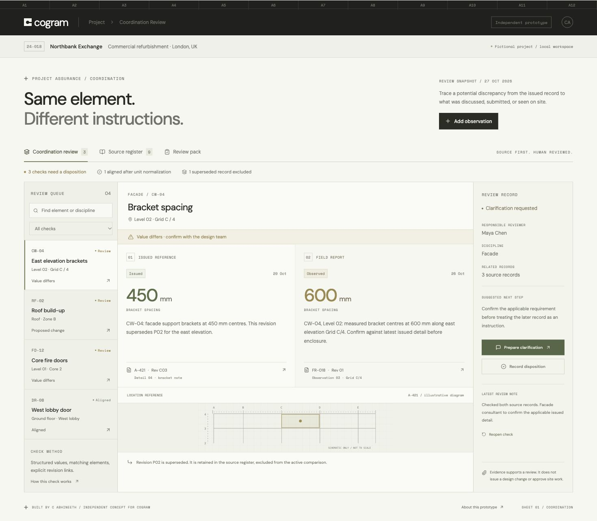

# Cogram Coordination Review

A working, independent product concept by C Abhineeth, tailored to Cogram's architecture and engineering project workflows.

A site observation says **600 mm**. The issued detail says **450 mm**. Which source is current, what changed, and who needs to clarify it?

This small workbench puts both excerpts next to each other, keeps superseded revisions out of the active comparison, and prepares a clarification for human review.



## Run locally

Use Node.js 20.19+ or 22.12+.

```sh
npm ci
npm run dev
```

Open http://127.0.0.1:5182/.

```sh
npm test
npm run build
```

## What works

- **Coordination review:** compare a current issued reference against observed, proposed, or submitted values for the same explicitly identified element.
- **Revision awareness:** exclude sources marked superseded or explicitly replaced by another source. Preserve their excerpts in the source register.
- **Unit normalization:** compare mm, cm, and m; compare minutes and hours; route incompatible dimensions to review. A 0.9 m record matches a 900 mm observation.
- **Evidence inspection:** open each source's excerpt, author, revision, status, date, locator, and structured value.
- **Clarification drafting:** generate an editable draft that includes both source excerpts and references. Export it as text. No messages are sent.
- **Review dispositions:** record a responsible reviewer and notes; require a supporting record reference before closing a check; reopen a check.
- **New observations:** add a structured observation, immediately compare it, inspect it, and remove a local observation if needed.
- **Review pack:** view an assembled handoff and export Markdown with source excerpts, references, owners, and dispositions.
- **Local persistence:** observations and reviews survive reloads in the same browser.
- **Responsive interface:** mobile comparison view, source dialog, and horizontally scrollable source register.

## Why this is relevant to Cogram

Research was performed on October 27, 2026 using Cogram's live website and public documentation.

- [Cogram Project](https://cogram.com/): an integrated platform across project documents, minutes, correspondence, RFIs, submittals, and field reports.
- [Changelog](https://cogram.com/changelog): shared project records, unified correspondence, project tasks, drawings, and an Agent already exist.
- [RFIs and Submittals](https://cogram.com/rfi-submittal-management): Cogram already offers Procore sync, review workflows, and AI checking against specifications.
- [Agent](https://cogram.com/agent): cross-record questions and decision/action tracking already exist.
- [Documentation index](https://docs.cogram.com/llms.txt): explicit document revision/version management, transmittals, automations, and field observations are documented.

The opportunity explored here is a narrow, inspectable review experience for potential discrepancies across those existing records. It is a proposed extension, not a verified missing feature or a reproduction of Cogram's private implementation. Public research did not establish an official application source repository to reuse.

The visual direction follows the live website's charcoal navigation, warm off-white surfaces, DM Sans / Space Mono typography, restrained borders, and architectural sheet indexing. No marketing photographs, proprietary product code, or client records were copied. The location diagram is an original schematic, explicitly not a construction drawing.

## Architecture and boundaries

React 19 and Vite. No server or credentials required. `src/engine.js` contains the pure comparison functions and fictional seed records. `src/main.jsx` contains the interactive workflow. Records and dispositions are saved under `cogram-coordination-v1` in localStorage.

The demo contains **9 fictional sources, 4 elements, 3 flagged comparisons, and 1 aligned comparison**. None of the dimensions or ratings are general design requirements. The people, project, and source excerpts are fictional.

This is a deterministic comparison of manually structured values. It does not perform OCR, infer values from excerpts, interpret drawings, retrieve external documents, call an LLM, or connect to Cogram, Procore, Outlook, or a live project. The structured value and excerpt may disagree if a user enters them incorrectly; review them against the original source.

The latest dated active issued record is selected per element, with source ID as a deterministic tie-breaker. That selection is a demo rule, not a determination of contractual precedence. A production integration would need source permissions, explicit contractual authority, field-level extraction provenance, revision lineage, human validation, and persistent audit history. This prototype records only the latest disposition per check.

Google Fonts supplies the two open-source font families; system fonts are fallbacks. No application data is sent to a backend. Browser storage is local and is not enterprise access control.

## Outreach assets

- `screenshots/01-coordination-review.jpg`
- `screenshots/02-source-register.jpg`
- `screenshots/03-review-pack.jpg`
- `OUTREACH.txt`: crisp email with literal repository and resume URLs.
- `examples/`: generated review pack and clarification text for direct inspection.
- `VERIFICATION.md`: checks and their limits.

Use screenshot 1 to demonstrate the core idea and screenshot 3 to show the handoff. Screenshot 2 is optional context for revision handling.
